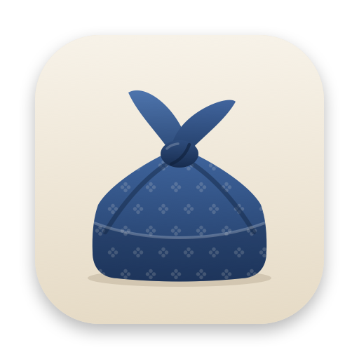

<p align="center">
  
</p>

<h1 align="center">Bottari</h1>

<p align="center">여러 서버와 클라우드를 한 창에서 다루는 macOS 파일 관리자</p>

<p align="center"><a href="https://github.com/Piorosen/Bottari/actions/workflows/ci.yml"></a></p>

보따리는 FileZilla 같은 두 패인 파일 관리자다. 왼쪽은 Mac, 오른쪽은 서버로 고정하지 않고, 두 패인 모두 Mac, SFTP 서버, S3, Google Drive, iCloud Drive 중 어디든 열 수 있다. 서버 사이 전송, 원격 파일 편집, 이미지와 영상 보기, SSH 터미널, 원격 화면을 한 앱에서 처리한다.

## 기능

### 파일

- 두 패인 모두 Mac, SFTP, S3(AWS, R2, MinIO), Google Drive, iCloud Drive 열기
- 드래그, ⌘C/⌘V, 우클릭으로 패인 사이 복사와 이동
- 보따리: 여러 서버의 파일을 모아 두었다가 한 위치로 한 번에 보내기, 프리셋으로 저장
- ⌘K 명령 팔레트로 폴더 이동, 연결, 명령 실행
- ⌘F로 지금 폴더 아래에서 이름 찾기(`*.log` 같은 패턴 포함). 명령을 쓸 수 있는 서버에서는 `find`로 서버에서 찾는다
- 권한 변경(하위 항목 포함), 심볼릭 링크 만들기
- 열 머리글로 이름, 크기, 수정일 정렬(폴더는 위). ⌥⌘U로 두 패인 바꾸기, ⌥⌘O로 반대편 패인에 같은 폴더 열기
- Mac에서는 대소문자나 한글 자모 조합(NFC/NFD)만 다른 이름도 같은 이름으로 보고 덮어쓰기 전에 묻는다

### 전송

- 서버 사이 전송. Mac을 거쳐 스트리밍하며 임시 파일을 만들지 않음
- 서버 간 직접 전송(전송 센터에서 켬, 기본은 꺼짐): 원본 서버가 `tar | ssh`로 대상 서버에 바로 보내 Mac을 거치지 않는다. 대상 로그인은 에이전트 포워딩으로 전송하는 동안만 빌려 준다(Mac의 ssh-agent, 또는 키 파일로 Bottari가 직접 서명. 개인 키는 Mac을 떠나지 않음). 대상의 호스트 키는 Bottari가 확인한 키로 고정한다. 원본에서 대상에 닿지 않으면 Mac 경유로 바꾼다. 비밀번호로 로그인하는 대상에는 쓸 수 없다
- 동시 전송 수, 같은 이름 처리 방식, 일시정지, 재시도, 이어받기. 연결이 잠깐 끊기면 파일마다 세 번까지 알아서 다시 시도한다
- 앱을 종료해도 끝나지 않은 전송을 기억했다가 다음 실행 때 이어서 보내기. 끝난 파일은 건너뛰고, 끊긴 파일은 받은 부분부터 이어 받는다
- 전송 후 SHA-256 비교, 수정 시각 보존
- 셸 명령을 쓸 수 있는 서버에서는 복사(`cp -a`), 압축, 압축 풀기를 서버에서 직접 실행

### 연결

- 비밀번호(키체인 저장), ssh-agent, 키 파일, `~/.ssh/config` 가져오기
- 에이전트와 키 파일 모두 Ed25519, ECDSA, RSA. RSA는 OpenSSH 8.8 이후 기본인 `rsa-sha2-512`로 서명한다. 키 파일은 OpenSSH 형식(암호 포함)과 PEM
- 에이전트에 맞는 키가 없으면 `ssh`처럼 `~/.ssh`의 `id_ed25519`, `id_ecdsa`, `id_rsa`로 이어서 시도
- 점프 호스트(ProxyJump)와 ProxyCommand를 거친 연결과 파일 전송. `~/.ssh/config`의 `Match`(host, user, localnetwork 등)도 반영한다
- 호스트 키 확인. `~/.ssh/known_hosts`(해시된 이름 포함)에 있는 키는 바로 믿고, 다르거나 `@revoked`인 키는 거부한다. known_hosts에 다른 종류의 키만 있으면 지문을 보여 주고 확인을 받는다
- 다른 Mac에서 동기화된 연결의 ProxyCommand는 이 Mac에서 한 번 허락해야 실행된다
- 서버가 조용하면 주기적으로 확인하고, 잠자기나 네트워크 변경으로 끊긴 연결은 다음 요청 때 자동으로 다시 연다
- PROD 태그: 패인 위 경고 띠, 쓰기 전 확인, 읽기 전용 열기

### 보기와 편집

- 이미지 갤러리
- 영상 재생(libmpv). 내려받지 않고 서버에서 바로 스트리밍
- 원격 텍스트 편집. 문법 색, 서버 쪽 파일이 바뀌면 3-way 병합. 심볼릭 링크로 연 파일은 링크가 가리키는 파일에 저장한다
- 외부 에디터로 열고, 저장하면 서버에 자동 업로드(그 자리에 덮어쓰는 VS Code, nano 포함). 올라가지 않은 변경이 있으면 종료나 중단 전에 묻는다

### 원격

- SSH 터미널(SwiftTerm). 스니펫, 여러 서버에 동시 입력
- VNC와 macOS 화면 공유(RoyalVNCKit). SSH 터널을 거쳐 연결
- SSH를 거치는 SOCKS/HTTP 프록시 터널

### 설정 (⌘,)

| 탭 | 내용 |
| --- | --- |
| 일반 | 전송 기본값, 업데이트 |
| 모양 | 테마(시스템, 종이, 먹, 쪽빛 밤, 모시, 고대비), 강조색, 밀도, 글꼴, 서버 태그 색. 테마는 JSON으로 가져오고 내보낸다(`~/Library/Application Support/Bottari/themes/`) |
| 단축키 | Finder식, Commander식(F5 복사, F6 이동, F7 새 폴더, F8 삭제). 키를 직접 눌러 지정하고 겹치는 키를 표시 |
| iCloud 동기화 | 연결 목록, 즐겨찾기, 테마, 단축키, 보따리 프리셋을 `iCloud Drive/Bottari/`에 JSON으로 두고 Mac끼리 병합. 양쪽에서 다르게 바뀐 항목은 어느 쪽을 쓸지 직접 고른다. 비밀번호는 파일에 쓰지 않는다. 기본은 꺼짐 |

### 언어와 진단

- 한국어와 영어 화면. macOS 언어 설정을 따른다
- 연결, 재연결, 전송 기록을 `~/Library/Logs/Bottari/bottari.log`에 남기고, 도움말 › 진단 정보 저장…으로 버전, 연결 요약(비밀번호 제외), 최근 로그를 파일 하나로 저장한다

## 요구 사항

- 실행: macOS 15 이상
- 빌드: Xcode 26 이상(Swift 6.2 이상)

## 빌드

처음 받을 때는 서브모듈도 함께 받는다. `Packages/swift-nio-ssh`는 SSH 에이전트 포워딩을 더한 [swift-nio-ssh 포크](https://github.com/Piorosen/swift-nio-ssh)이고, `Packages/Citadel`은 그 포크를 쓰도록 바꾼 [Citadel 포크](https://github.com/Piorosen/Citadel)다.

```sh
git clone --recurse-submodules https://github.com/Piorosen/Bottari.git
# 이미 받았다면
git submodule update --init
```

```sh
make build      # Debug 빌드
make run        # 빌드 후 실행
make test       # BottariKit 패키지 테스트(swift test)
make snapshots  # 화면 스냅샷과 자체 점검
make open       # Xcode로 열기
```

빌드 결과는 저장소가 아니라 `~/Library/Developer/Xcode/DerivedData/Bottari-make`에 둔다. 저장소가 데스크탑이나 문서 폴더 안에 있으면, 그 안에서 빌드한 앱이 실행될 때마다 macOS가 그 폴더 접근을 다시 묻기 때문이다. 키체인에 Apple Development 인증서가 있으면 그것으로 서명해서, 빌드를 다시 해도 macOS가 같은 앱으로 알아보고 이전에 허용한 권한을 유지한다. 인증서가 없으면 ad-hoc으로 서명한다.

`xcode-select`가 Command Line Tools를 가리키고 있으면 Swift가 오래된 버전이라 빌드되지 않는다. 시스템 설정을 바꾸지 않으려면 명령마다 Xcode를 지정한다.

```sh
DEVELOPER_DIR=/Applications/Xcode.app/Contents/Developer make build
```

Xcode에서 테스트하려면 `Packages/BottariKit/Package.swift`를 열고 ⌘U를 누른다.

### 화면 스냅샷

Debug 빌드는 창을 띄우지 않고 샘플 데이터로 각 화면을 PNG로 그릴 수 있다. 편집기, 플레이어, VNC, 설정, 동기화는 스스로 점검한 결과를 `*-check.txt`에 PASS/FAIL로 남긴다. 사용자의 테마, 단축키, 연결 목록, 전송 기록은 건드리지 않는다.

```sh
make snapshots SHOTS=/tmp/bottari-shots
```

### 아이콘

앱 아이콘과 사이드바, 툴바의 선 아이콘은 코드로 그린다. 스크립트를 고친 뒤 다시 생성한다.

```sh
swift scripts/app-icon.swift Bottari/Assets.xcassets/AppIcon.appiconset docs/icon.png
swift scripts/glyphs.swift Bottari/Assets.xcassets/Glyphs
```

## 배포

App Store에는 올리지 않는다. 앱 샌드박스 없이 Developer ID로 서명하고 공증한 DMG로 배포하며, 업데이트는 Sparkle로 받는다.

처음 한 번:

1. Developer ID Application 인증서를 키체인에 설치한다.
2. 공증 프로필을 만든다: `xcrun notarytool store-credentials bottari-notary --apple-id … --team-id …`
3. Sparkle 키를 만든다: `scripts/sparkle-keys.sh`. 개인 키는 로그인 키체인에 저장되고, 출력된 공개 키는 다음 단계에서 쓴다.
4. `cp Config/release.env.example Config/release.env` 후 `TEAM_ID`, `SPARKLE_PUBLIC_KEY`를 채운다. 이 파일은 커밋하지 않는다.
5. (선택) Google Cloud에서 "데스크톱 앱" 유형의 OAuth 클라이언트를 만들어 `GOOGLE_CLIENT_ID`, `GOOGLE_CLIENT_SECRET`에 넣으면, 사용자가 클라이언트를 따로 만들지 않고 Google Drive에 로그인할 수 있다. 동의 화면을 게시하지 않으면 7일마다 다시 로그인해야 한다.

릴리스마다:

```sh
make release   # .build/release/에 Bottari-<버전>.dmg, .zip, appcast.xml 생성
gh release create v0.1.0 .build/release/Bottari-0.1.0.dmg .build/release/Bottari-0.1.0.zip .build/release/appcast.xml
```

앱은 `https://github.com/Piorosen/Bottari/releases/latest/download/appcast.xml`에서 업데이트를 확인한다. 공개 키가 없는 빌드(Debug, `make package`)는 업데이트를 확인하지 않는다. `make package`는 서명 없이 같은 과정을 실행해 파이프라인만 점검한다.

## 구조

```
Bottari/                macOS 앱(SwiftUI)
  Panes/ Sidebar/       패인, 사이드바, 보따리
  Transfers/            전송 막대, 전송 센터, 연결 유지
  Sites/                연결 관리
  Viewers/              갤러리, 플레이어, 편집기
  Remote/ Tunnels/      터미널, 원격 화면, 터널
  Settings/             테마, 단축키, iCloud 동기화, 설정 창
  Design/               색, 글꼴, 공용 컨트롤, 아이콘 뷰
  Debug/                스냅샷 렌더러와 샘플 데이터
  Assets.xcassets/      앱 아이콘, 강조색, 선 아이콘(Glyphs)
Packages/BottariKit/    앱과 분리한 핵심 로직
  BottariCore           RemotePath, FileItem, FileProvider, LocalFileProvider, 3-way 동기화 폴더
  BottariSFTP           SFTP(Citadel), 저장된 연결, ~/.ssh/config, 점프 호스트, PTY, 포트 포워딩, 프록시
  BottariTransfer       전송 큐, 파일 캐시
  BottariEditor         문법 색, 문자 인코딩, 3-way 병합
  BottariPlayer         libmpv(MPVKit) 스트리밍
  BottariRemote         SwiftTerm, RoyalVNCKit
  BottariCloud          S3(SigV4), Google Drive(AppAuth)
Config/                 Info.plist 추가 키, 릴리스 설정 예시
scripts/                release.sh, sparkle-keys.sh, app-icon.swift, glyphs.swift
docs/                   README 이미지
```

설계 메모:

- 모든 패인은 `FileProvider` 프로토콜로만 파일을 다룬다. 서버 사이 전송은 한쪽의 `read` 스트림을 다른 쪽 `write`에 연결하면 끝난다. 읽기는 받는 쪽이 가져가는 만큼만 진행하므로 큰 파일도 메모리에 쌓이지 않는다.
- 쓰기는 대상 옆 임시 파일(`.이름.bottari-part`)에 먼저 쓰고 마지막에 이름을 바꾼다. 전송이 끊겨도 원본은 그대로 남고, 임시 파일에서 이어 쓸 수 있다.
- 위치는 계정뿐 아니라 거쳐 가는 점프 호스트까지 포함해 구분한다. 서로 다른 점프 호스트 뒤의 `127.0.0.1:포트`를 같은 서버로 취급하지 않는다.
- Xcode 프로젝트는 폴더 동기화 방식이라 `Bottari/` 아래에 파일을 추가해도 프로젝트 파일을 고치지 않아도 된다.

## 라이선스

MIT. libmpv(MPVKit)는 LGPL 빌드를 사용한다. 함께 배포하는 IBM Plex 글꼴은 SIL Open Font License를 따른다.
